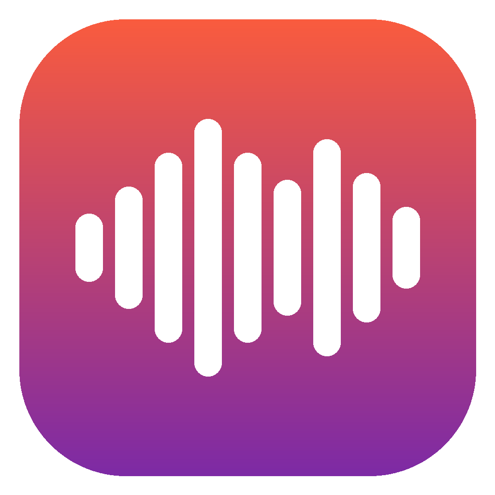
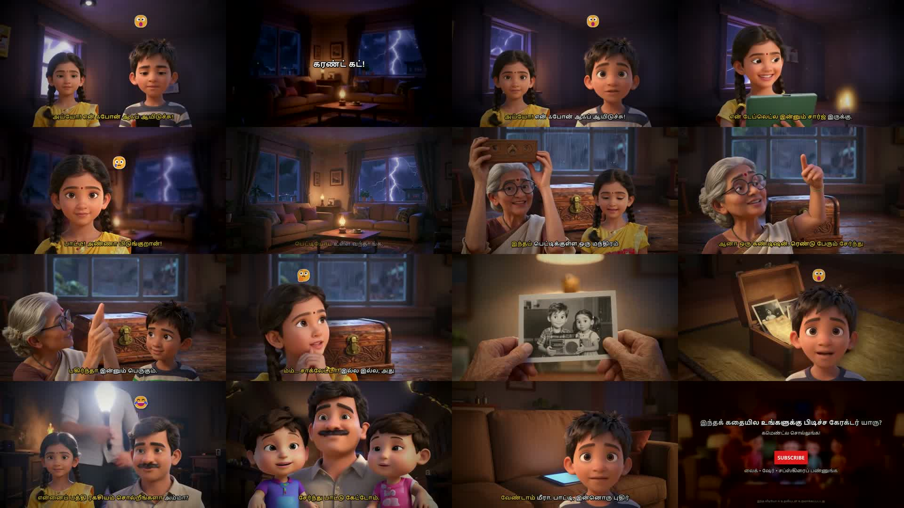
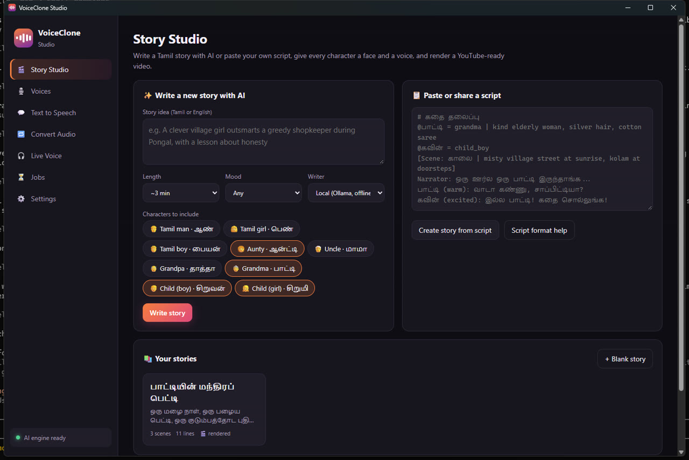
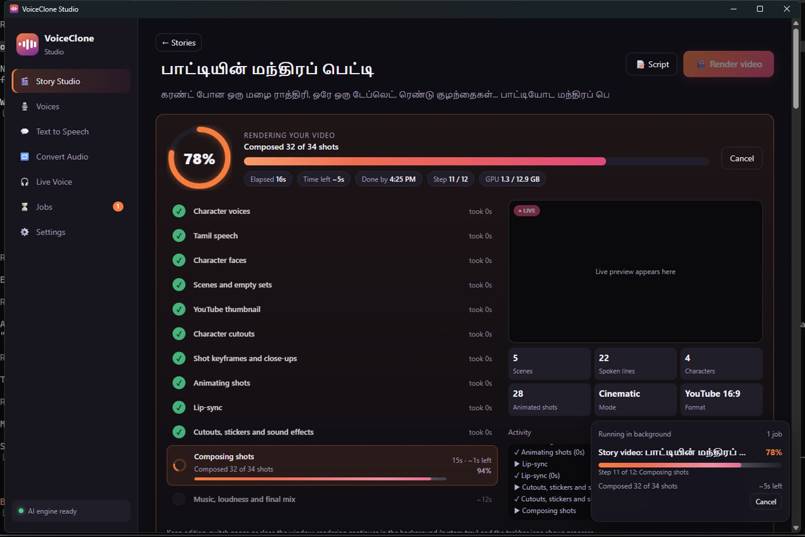

<div align="center">



# VoiceClone Studio

**Clone voices, speak Tamil, and turn stories into animated YouTube videos, all on your own PC.**

Free and open source · Runs locally on your NVIDIA GPU · No account, no cloud required

[**⬇ Download the installer**](../../releases/latest) · [Install guide](docs/INSTALL.md) · [User guide](docs/USER_GUIDE.md) · [Script format](docs/SCRIPT_FORMAT.md) · [Developer guide](docs/ARCHITECTURE.md)



</div>

## What it does

| | |
|---|---|
| 🎬 **Story Studio** | Write a Tamil story with AI (offline with Ollama, or Claude) or paste your own script. Every character gets an AI face and voice, and the app renders a YouTube (16:9) or Shorts (9:16) video with **animated, lip-synced characters**, scene art, karaoke subtitles, emoji reactions, sound effects, music, a thumbnail and a ready-to-paste description with chapters. |
| 🧬 **Voice cloning** | Clone a voice from any MP3/WAV into a portable **`.vcpt` checkpoint**. Download, share and upload checkpoints. |
| 💬 **Text to speech** | Type Tamil (or 600+ other languages) and hear it in any cloned voice. |
| 🔁 **Convert audio** | Re-voice a recording (story, podcast) in another voice, keeping the words, timing and emotion. |
| 🎧 **Live voice** | Speak into your mic and hear yourself in a cloned voice in real time. |
| 👨‍👩‍👧 **9 Tamil character voices** | Man, girl, boy, aunty, uncle, grandpa, grandma, child boy and child girl. They are designed by AI, checked for clarity and age-appropriate pitch, and replaceable with your own recordings. |
| ✏️ **Fix after rendering** | Type *"at 1:22 change Appa's shirt to blue"*, *"fix the lip-sync"* or *"say it slower"*, or click a shot in the timeline. Only that part is regenerated, and every render is kept as a version. |
| ♻ **Smart cache** | Identical voice lines, faces, scenes, animated shots, lip-syncs and composed shots are never generated twice. Recurring characters stay identical across episodes, and your channel intro/outro is prepared once. |
| 📦 **Downloads** | MP4, thumbnail, Tamil subtitles (.srt), audio (.mp3) and a one-click 9:16 Shorts teaser. |
| ⏳ **Background jobs** | A detailed progress panel shows every step, live preview, time left and GPU use. Work continues in the system tray and the taskbar icon shows progress. **⏸ Pause / ▶ Resume** at any time. |

<p align="center">
  
  
</p>

## Install (Windows)

1. **Download** `VoiceClone Studio_x.y.z_x64-setup.exe` from [Releases](../../releases/latest) and run it.
2. **Open** VoiceClone Studio from the Start menu or desktop.
3. On first launch, click **⬇ Set up AI engine**. It installs Python, PyTorch for your GPU and the AI models automatically. This is a one-time download of about 25–60 GB and takes 20–60 minutes.
4. Write or paste a story and click **🎬 Render video**.

**Requirements:** Windows 10/11 · NVIDIA GPU with 8 GB+ VRAM (12 GB recommended; tested on an RTX 4070 SUPER) · 32 GB RAM · 80 GB free disk · internet for the one-time setup. Optional: [Ollama](https://ollama.com) for offline story writing.

Full details and troubleshooting: **[docs/INSTALL.md](docs/INSTALL.md)**.

## Render speed (RTX 4070 SUPER, 12 GB)

| A 2-minute story | Fast mode | Cinematic mode |
|---|---|---|
| First render | ~15–25 min | ~25–35 min |
| Re-render after editing one line | ~1–3 min | ~2–4 min |

Everything is cached per line, so changing one line only redoes that line.

## How it works

```
Tauri app (Rust): UI, jobs, live audio (cpal), ffmpeg compositor, story pipeline
        │  HTTP + WebSocket (127.0.0.1, per-launch token)
Python GPU worker: OmniVoice (TTS + cloning) · Seed-VC (voice conversion) · Z-Image-Turbo (faces, scenes)
                   LTX-Video 2B (shot animation) · LatentSync (lip-sync) · SadTalker (fast talking faces)
```

See **[docs/ARCHITECTURE.md](docs/ARCHITECTURE.md)** for the pipeline, the checkpoint format, the engine API and how to build from source.

## Licenses & responsible use

App code: **GPL-3.0-or-later**. Models are downloaded from their official sources and keep their own licenses:

- OmniVoice: Apache-2.0
- Seed-VC: GPL-3.0
- Z-Image-Turbo: Apache-2.0
- LTX-Video: LTX Open Weights License, free for entities under $10M annual revenue
- LatentSync: OpenRAIL++
- SadTalker: Apache-2.0
- whisper-tamil-medium: Apache-2.0

Only clone voices you own or have permission to use, and never clone a child's voice without their parents' consent. Label AI-generated content when you publish; YouTube requires disclosure of realistic synthetic media, and the app adds an AI disclosure to the end card and description.
