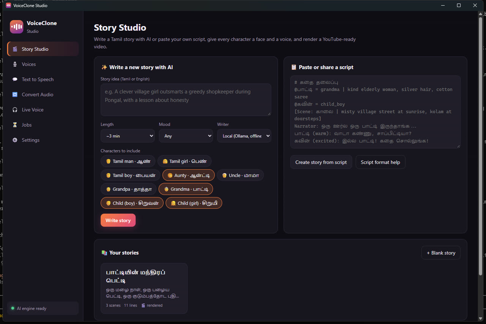
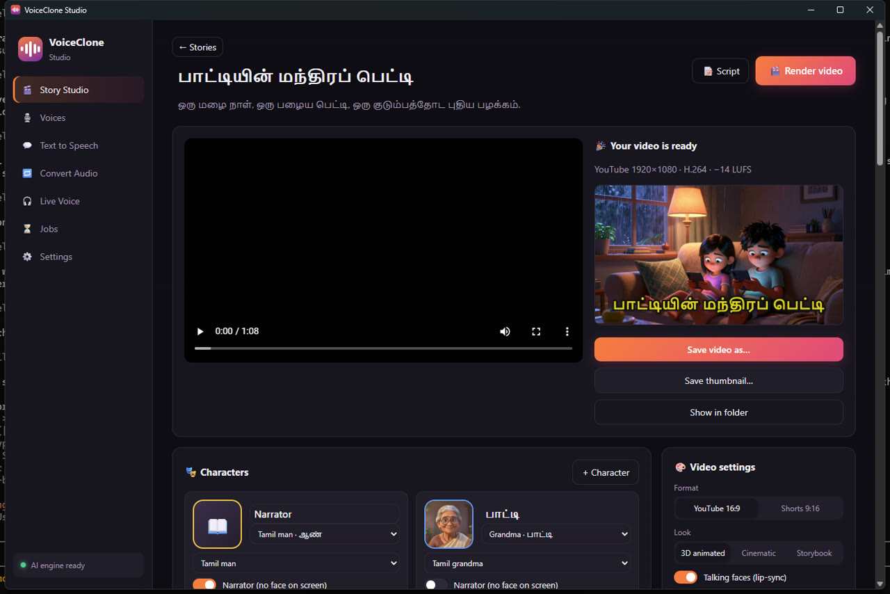
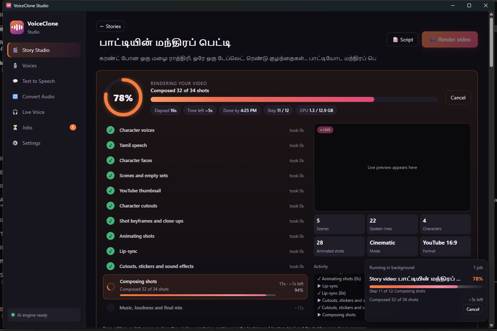
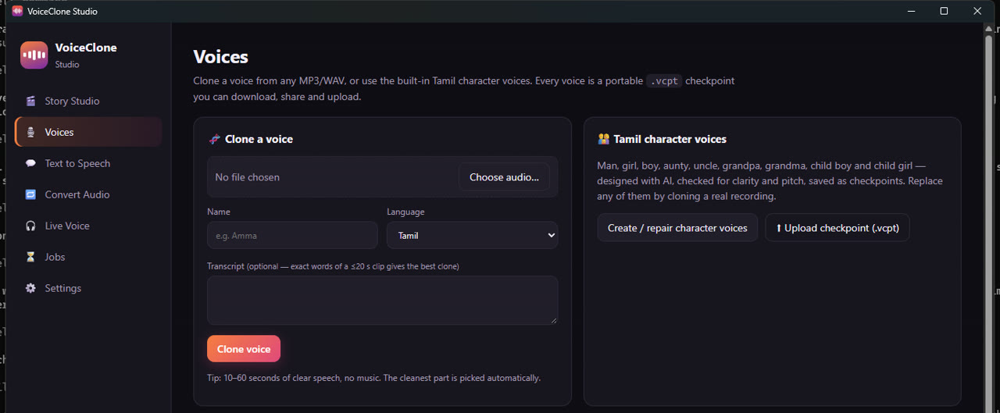

# VoiceClone Studio — User guide

- [Story Studio: make a video](#story-studio-make-a-video)
- [Voices: clone, download, upload](#voices)
- [Text to Speech](#text-to-speech)
- [Convert Audio](#convert-audio)
- [Live Voice](#live-voice)
- [Jobs, progress and background mode](#jobs-progress-and-background-mode)
- [Settings](#settings)
- [Tips for great Tamil videos](#tips-for-great-tamil-videos)

---

## Story Studio: make a video

### 1. Start a story

Use either of these:

- **✨ Write a new story with AI.** Type an idea in Tamil or English, for example *"A clever village girl outsmarts a greedy shopkeeper during Pongal"*. Choose the length and mood, tick the characters you want, pick a writer, and click **Write story**.
  - **Local (Ollama)** works offline, free, in 1–3 minutes.
  - **Claude** writes the best modern Tamil and needs an API key.
- **📋 Paste or share a script.** Paste a script in the [script format](SCRIPT_FORMAT.md) and click **Create story from script**. This is also how you share stories: **📝 Script** inside a story shows its script for copying.

The writer follows screenplay rules:

- a hook in the first seconds
- a clear conflict and a twist
- one **viewer question** (a pause-and-guess moment)
- close-up **insert shots**
- a warm ending instead of a lecture

### 2. Check characters

Each character card has the following:

- **Name**: for your reference. It isn't shown on screen; viewers recognise characters by face and voice.
- **Voice type**: man, girl, boy, aunty, uncle, grandpa, grandma, child boy or child girl. **▶ Voice** plays it.
- **Voice**: *Auto* uses the built-in voice for that type. Pick any cloned voice instead (e.g. your own).
- **Narrator**: the narrator is heard but never shown.
- **Look**: an English description used to paint the face (age, hair, clothes, one distinctive feature).
- **🎨 Make face / New face**: paints a portrait now. **⬆ Photo** uses your own image.

### 3. Check scenes and lines

Every scene has a title (shown as a scene card), a background description and lines:

- **Speaker, emotion and text**: edit the Tamil freely. Editing a line re-records just that line on the next render.
- **🔊 / ▶**: generate and play that line's voice now.
- Scene buttons:
  - **🎨 Paint**: paints the background.
  - **⬆ Image** / **⬆ Video**: use your own picture or clip as the background.

### 4. Choose video settings

| Setting | Options |
|---|---|
| Format | **YouTube 16:9** or **Shorts 9:16** |
| Look | **3D animated**, **Cinematic** (photoreal) or **Storybook** (painted) |
| Animation | **🎬 Cinematic**: every shot animated (gestures, body and scene motion) plus lip-sync; realistic, about 1 minute per shot. **⚡ Fast**: characters cut out into the scene with lip-synced faces; much quicker. |
| Lip-sync faces / Tamil subtitles | On or off |
| MiniMax H3 cinematic scenes | Paid cloud clips (needs an API key) |
| Background music | Any audio file. It ducks automatically under voices. |

### 5. Render

Click **🎬 Render video**. The progress panel shows the following:

- the **overall percentage**, elapsed time, time left, when it will be done, and GPU memory
- a **step checklist**: voices → speech → faces → scenes → thumbnail → cutouts → shots → animation → lip-sync → composing → final mix. Each step has its own progress and timing; cached steps show *cached ✓*.
- a **live preview** of the face, scene or shot being generated
- **story facts** and an **activity log**

You can switch pages or close the window, and rendering keeps going in the system tray. The taskbar icon shows progress.

### 6. Download

When the video is done:

- **⬇ Download video (MP4)** saves an H.264 MP4 at −14 LUFS, the YouTube standard.
- **🖼 Thumbnail** saves the Tamil-title thumbnail.
- **💬 Subtitles .srt** saves Tamil captions; upload them to YouTube as closed captions.
- **🎵 Audio .mp3** is for podcasts and WhatsApp.
- **📱 Shorts teaser** makes a ≤ 58 s vertical 9:16 cut of the hook, the best moments and the viewer question, with the title on top.
- **Copy description** copies the title, summary, **chapters**, characters, hashtags and an AI disclosure.

On YouTube, tick **"Altered or synthetic content"** in the upload form.

### 7. Fix or improve anything after rendering

You never need to start over. Under the video:

- **Shot timeline:** every shot has a thumbnail and timestamp, and the current one is highlighted while you watch. Click a shot to jump there and get quick fixes:
  - 👄 **Fix lip-sync**: stronger, more accurate mouth sync
  - 🔁 **New animation**: different motion
  - 🗣 **New voice take** / 🐢 **Slower**
  - ✏️ **Edit words**
  - 🎨 **Change look**: affects that character everywhere
  - 🖼 **Repaint background**
  - 🗑 **Remove**
- **✏️ Fix or improve something:** type what you want in plain words. Click **⏱ Use current time** while watching, or write the time in the request:
  - *"at 1:22 change Appa's shirt to blue"*
  - *"give Paati grey hair and a red saree"*
  - *"fix the lip-sync"*
  - *"say it slower"*
  - *"change the words to “அய்யோ! என் கேம் போச்சு!”"*
  - *"make the background daytime"*
  - *"animate again with a big smile"*
  - *"delete this line"*

**Preview change** shows the plan: what will change, an editable value (new look, words or background), how many shots are affected, and the time estimate. **✅ Apply & regenerate** redoes **only those shots**; everything else is reused, so a lip-sync fix takes about 2 minutes and a look change a few minutes. **Apply, render later** lets you queue several fixes and render once.

### 8. Versions

Every render is kept as **v1, v2, v3…** with a note such as *"Fixed lip-sync at 0:20"*. You can ▶ play, ⬇ download, or **Use** any version again.

---

## Voices

- **Clone a voice:** choose an MP3/WAV with 10–60 s of clear speech and no music, give it a name and language, then click **Clone voice**. The cleanest part is picked automatically. For the best clone, use a ≤ 20 s clip and type its exact words in **Transcript**.
- **Tamil character voices:** **Create / repair character voices** builds the nine built-in voices.
- **⬇ Download** saves a voice as a `.vcpt` checkpoint you can back up or share. **⬆ Upload checkpoint** imports one.
- **✎ Edit**: rename, or correct the reference transcript (a better transcript gives a better clone).
- **Replace a character voice:** clone a real recording, then choose it in a character's **Voice** menu.

> Consent matters: only clone voices you own or have permission to use. Recordings of children need their parents' consent.

## Text to Speech

Pick a voice, type text, and click **Speak**. Modes:

- **Auto**: recommended.
- **Direct clone**: the most expressive.
- **Stable**: the most consistent.

**Save as…** exports a WAV.

## Convert Audio

Choose a recording and a target voice, then click **Convert**. The words, timing and emotion stay; the voice changes. Quality goes from *Fast* to *Best*.

## Live Voice

Choose a voice, microphone and output (use **headphones**), then click **▶ Start**.

- **Latency** trades delay for smoothness.
- **Quality** trades GPU load for clarity.
- **Noise gate** mutes background noise between words.

If *GPU ms / block* is higher than the block length, lower the quality or raise the latency.

## Jobs, progress and background mode

- The **Jobs** page lists every task with its percentage, stage, time left and a cancel button.
- The floating box at the bottom right shows running jobs on every page.
- Closing the window hides the app to the **system tray**, and jobs continue. Right-click the tray icon and choose **Quit** to really exit.

## Settings

- **AI engine:**
  - status and log
  - **Install / repair engine**
  - **Engine folder**: use an existing engine
  - restart the engine, free GPU memory, open the data folder
- **Story writer:** the default writer, local model, and Anthropic API key.
- **MiniMax H3:** API key and model.
- **Channel intro & outro:** your own intro and outro clips are added to every story video. They're prepared once and reused.
- **Cache:** shows how much repeated work is being reused, with a **Clear cache** button.
- **App:** keep running in the background, and auto-start the engine.

API keys are stored only on your PC (`%APPDATA%\VoiceCloneStudio\settings.json`) and are shown masked.

## Tips for great Tamil videos

- **Keep lines short:** one or two spoken sentences each. Short lines sound more natural and animate better.
- **Give every line an action** (`Name (happy | claps her hands): ...`). It drives the animation.
- **Insert shots should show objects, hands or places, never people.** Characters only appear in their own dialogue shots.
- **Keep actions about the speaker.** "Puts an arm around both kids" makes the AI invent extra children.
- **Animals and magical beings** sound best with the child or grandparent voices.
- **Use one viewer question per story.** Kids love pausing to guess.
- **For your own channel voice,** clone your voice and assign it to the Narrator.
